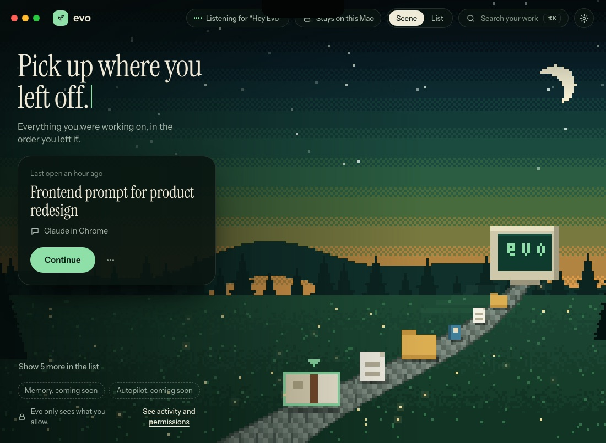
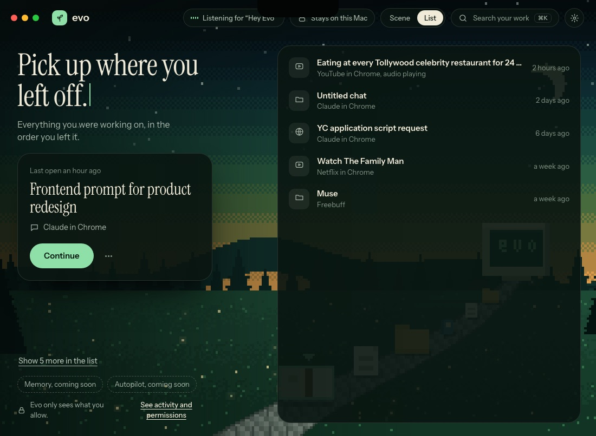
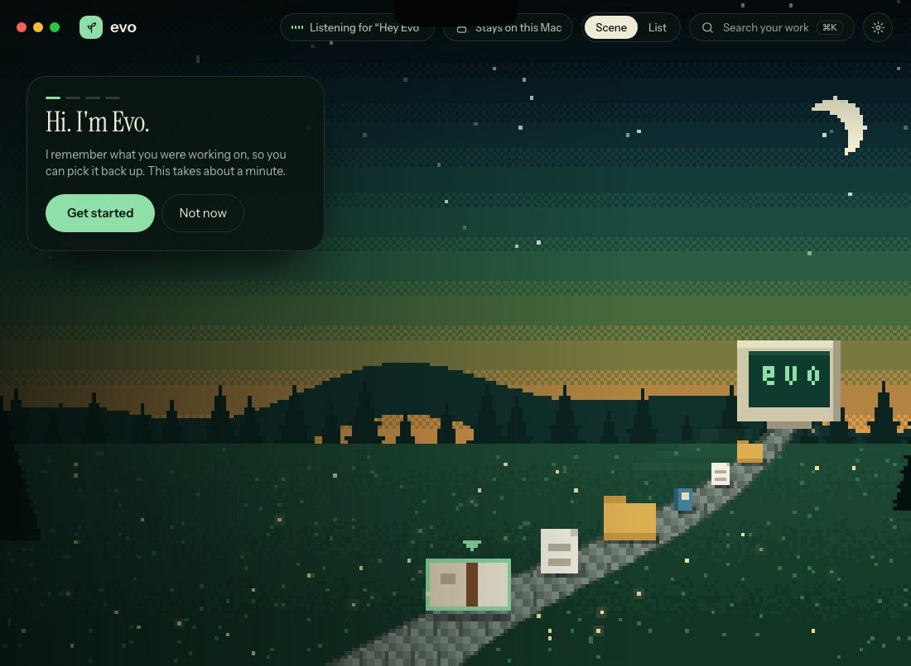
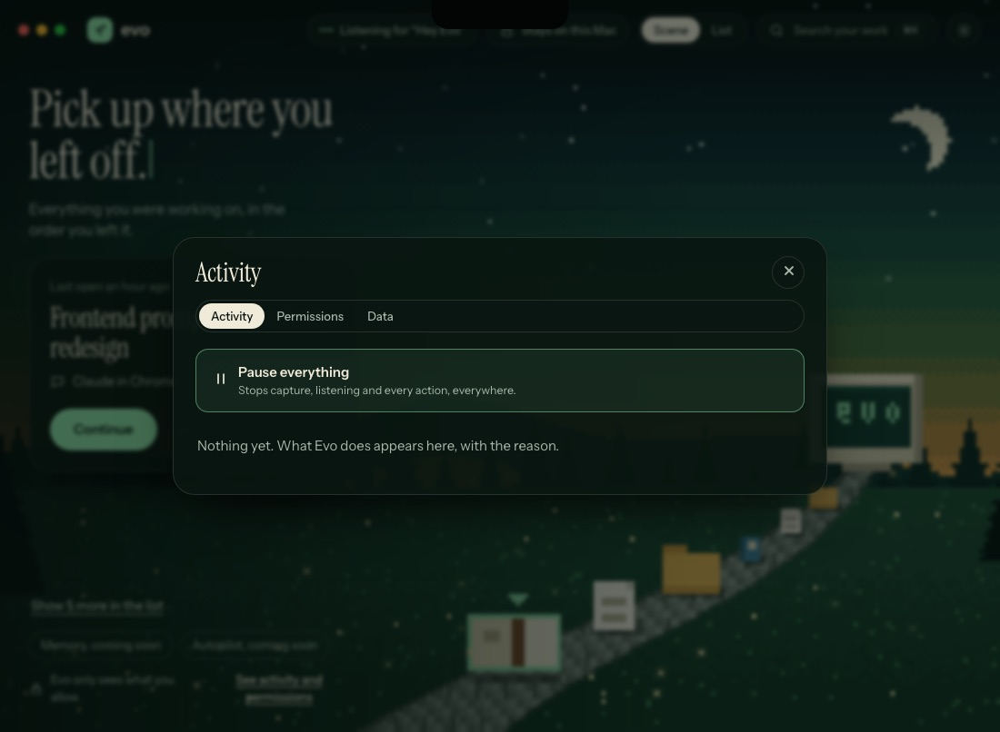
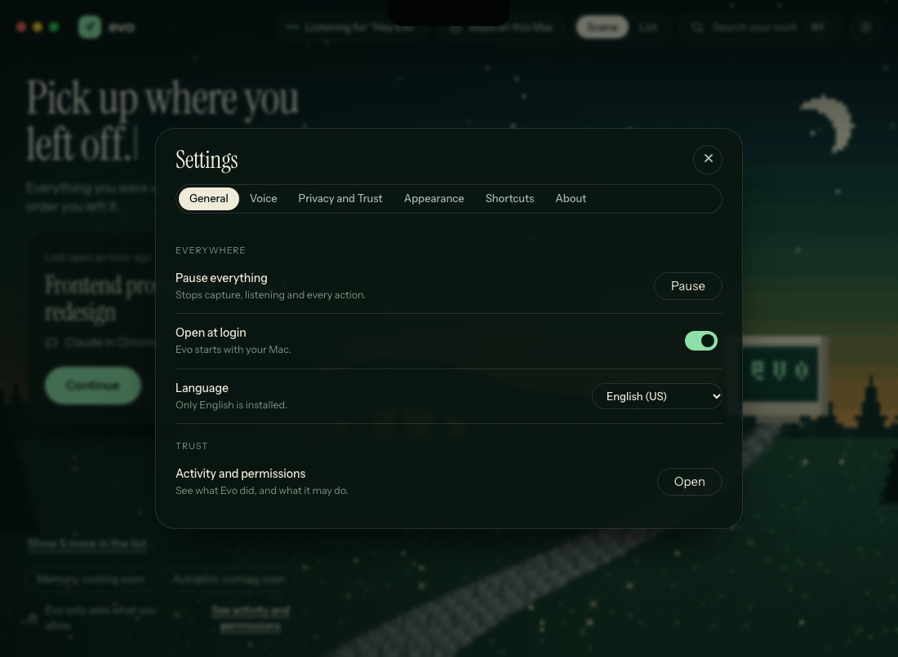

<div align="center">


### Your work, ready when you are.

**Say “Hey Evo” and the window you left comes back.**

[Screenshots](#screenshots) · [How it works](#how-it-works) · [Build it](#build-it) · [What is in 0.1.0](#what-is-in-010) · [What is coming](#what-is-coming) · [What is real](#what-is-real-and-what-is-not)

<sub>macOS 13+ · native shell over a local Rust runtime · no account, no server, no network client</sub>

</div>

---

Evo is a macOS app that remembers where you were and puts it back.

You work in a document, three browser tabs and a folder. A message arrives, a meeting happens, the laptop closes. When you come back, the work is still there — but you spend the first ten minutes finding the pieces and working out which one you were in.

Evo watches the ordinary signals of your computer use — the focused window, the file it belongs to, the URL — groups them into **bodies of work**, and gives you one action: open the one you left. Say “Hey Evo, open the Q3 roadmap”, or press `⌘K` and type a few letters. The notch at the top of the screen expands, listens, confirms, and the window comes forward.

There is no account, no sync, and no request leaving the machine. Voice, search and grouping run on the device.

---

## Screenshots



*Home. The clearing, the path with your work objects on it, one Continue card, and the notch above everything.*



*List view — the same set as rows, for the keyboard: arrow keys move, Enter opens.*

<table>
<tr>
<td></td>
<td></td>
</tr>
<tr>
<td></td>
<td align="center"><sub><b>First run</b> is four skippable steps and resumes where it stopped.<br><br><b>Activity</b> lists what Evo did, when and why, with undo — and one kill switch.<br><br><b>Settings</b> holds voice, privacy and trust, appearance, shortcuts and updates.</sub></td>
</tr>
</table>

<sub>These are captures of the web shell in `ui/app/` — the reference implementation the native window is measured against (ADR 0005). The native window renders the same tokens and the same scene; it has not been screenshot-diffed here, and `docs/LAUNCH.md` says so.</sub>

---

## How it works

```
  focused window · file events · URLs
              │
              ▼
     evo-capture          witnessed evidence, never screen pixels
              │
              ▼
   observation log  ──▶   evo-daemon          the canonical owner
              │                 │
              │                 ▼
              │            evo-ledger         ledger.db, ordered records
              │                 │
              │                 ▼
              └──────────▶ evo-threads        grouping, assignment, retrieval
                                │
                                ▼
                        evo-desktop (egui)     Home · scene · notch · tray
```

The engine decides what belongs together. The shell renders a projection of that decision and duplicates no semantics of its own. Sixteen crates, none of them talking to the network.

| Layer | Owns |
|---|---|
| `evo-capture` | window / accessibility evidence, input counters. Never writes canonical state. |
| `evo-observation` | candidate validation, canonicalization, provenance |
| `evo-artifact` | what a piece of work *is* — identity and integrity |
| `evo-ledger` | `ledger.db` and its ordered records |
| `evo-threads` | grouping, assignment and retrieval over the ledger |
| `evo-workspace` · `evo-restoration` · `evo-execution` | where the work is, how it comes back, and opening it inside scope |
| `evo-voice` | microphone, wake word and transcription, all on device |
| `evo-daemon` | the runtime owner; validates every declaration |
| `evo-desktop` | the window, the notch, the menu bar, the scene |

Full detail in [`ARCHITECTURE.md`](ARCHITECTURE.md) and [`docs/adr/`](docs/adr/).

### Three commitments

1. **No screenshots, ever.** Evo reads the focused window's title, its document and its URL. There is no screen recording, no keystroke log, and `crates/evo-desktop/tests/trust_constraints.rs` fails the build if a capture or HTTP crate appears anywhere in the workspace.
2. **Audio never leaves RAM.** The wake word and the transcript are local; audio is not written to disk. Voice is compiled in and declared to macOS only when you build with `EVO_VOICE=on`.
3. **Nothing happens invisibly.** Every capability has a scope, an action and a mode (ask every time / ask for risky actions / act within scope). Out-of-scope is refused in every mode. One switch pauses capture, listening and every action, from the notch, the menu bar or a shortcut.

---

## Build it

### What you need

- macOS 13 or later. Building an `.app` bundle only works on macOS.
- Rust (stable, edition 2024) and the Xcode command line tools — `xcode-select --install`.
- `python3` for the doctor and packaging helpers. No `pip install`, no network.

### Quick start

```bash
git clone https://github.com/BHAVIT-EVO/architecture-v1
cd architecture-v1

# 1. A stable local signing identity. Accessibility is granted to a code
#    requirement, not to an app name, so an ad-hoc signature loses the grant
#    on every rebuild. Do this once.
bash scripts/sign-dev.sh --create-identity

# 2. Build the passive app (no microphone, no voice models) into /Applications.
bash scripts/build-app.sh

# 3. Keep capture running across reboots and quits.
bash scripts/install-agents.sh

# 4. Open it.
open /Applications/Evo.app
```

Then say “Hey Evo” — after step 5, below, because the passive build has no microphone.

### The voice build

“Hey Evo” needs the microphone and four local models, so it is opt-in:

```bash
EVO_VOICE=on EVO_UI=web bash scripts/build-app.sh
```

The build refuses to produce a bundle rather than ship a voice-enabled app with a missing model. It also expects a reviewed ONNX Runtime 1.29 `arm64` dylib; it looks in `vendor/ort` (pinned by `scripts/ort.sha256`), in an installed `Evo.app`, in `target/`, and finally in the `ort` crate cache — and prints every path it rejected when it fails. Point it at a runtime with `ORT_LIB_PATH=/dir/containing/libonnxruntime.1.dylib`. Voice models need macOS 14 for the bundled runtime path.

Install the voice agent, which then owns the capture daemon:

```bash
/Applications/Evo.app/Contents/MacOS/evo-agent-install
```

Other build switches: `PROFILE=dev` for a debug bundle, `EVO_APP_OUTPUT_DIR=/some/fresh/dir` to build outside `/Applications` (bundled mode refuses to overwrite an existing bundle), `EVO_NOTCH=off` to drop the notch.

### The web surfaces

Nothing here needs a bundler. Serve the repository root so the pages can reach `ui/`:

```bash
python3 -m http.server 8000
```

- `http://localhost:8000/ui/gallery.html` — the design system: tokens, type, components, the scene.
- `http://localhost:8000/ui/app/home.html` — the Home shell used for measurement, on sample data. This has a mock bridge; the shipped app does not.
- `http://localhost:8000/site/index.html` — the public website (10 pages, reads without JavaScript).

### Tests

```bash
cargo fmt --check
cargo test --workspace
cargo test -p evo-desktop --test trust_constraints   # no network, no screen capture, voice opt-in only
cargo test -p evo-desktop --test journeys            # first run, first wake, open, pause, refusal
cd ui && node --test "home/*.test.js"

cargo audit          # one known advisory in bundled SQLite — see SECURITY.md
python3 scripts/evo-doctor.py --report-only
```

`cargo clippy --workspace -D warnings` is **not clean yet**; see [what is real](#what-is-real-and-what-is-not).

---

## What is in 0.1.0

**Home.** The clearing at dusk — 320×180, seeded, 12 fps, paused when hidden — with your work as objects on the path. A Continue card for the newest, Scene and List views over the same set, `⌘K` search, arrow keys, hover previews, and rename / merge / hide / “This isn't work”, all reversible.

**The notch.** Resting, wake, listening with a live equaliser, thinking, acting, done, needs you, error with retry, paused. Up to three choices when several works match; a plain sentence when none do. `⌥Space` listens, `⌥⌘P` pauses.

**First run.** A short intro, then four skippable steps that resume where they stopped — what Evo is, the microphone, window access, and saying “Hey Evo” for real.

**Trust.** Permissions in three scopes and three modes, Activity capped at 100 rows with one-shot undo, one kill switch, plus Settings, Help, Diagnostics and the tray. Every state is designed: loading, empty, error, offline, permission denied. Export your data, or delete everything.

**The website.** `site/` — home, download, thank-you, guide, privacy and trust, changelog, about, contact, privacy policy, terms, and a 404 with one lost object on the path. Self-hosted fonts, `sitemap.xml`, `robots.txt`, structured data, and copy that reads without JavaScript.

[`CHANGELOG.md`](CHANGELOG.md) has the long version.

---

## What is coming

Named here so you can hold us to it. None of it has a date.

| | What it means |
|---|---|
| **Memory** | Evo keeps the thread between sessions — what a work was *for*, not just where it was. Shown in the app today only as a quiet “coming soon” label, with no fake button behind it. |
| **Autopilot** | Small chores inside a scope you set, asking first for anything risky. Off until you turn it on. The permission model it needs is already built and tested; the acting is not. |
| **Ten people outside the company, for thirty days** | Everything above is speculation until the boundary is proven on more than one machine. This is the next real thing, not a feature. |
| **A signed, notarised installer** | The download page's buttons lead to the setup page today because no signed build is attached. Signing needs an Apple Developer account and there is no way around that. |

---

## What is real, and what is not

We would rather you trust the numbers we can show.

### Real

- The engine, the ledger, the daemon, the voice path and the native shell — 16 crates, built and tested on one machine.
- **The offline promise, as a test.** `trust_constraints.rs` walks every `Cargo.toml` and every `.rs` file in the workspace and fails the build if `reqwest`, `hyper`, `ureq`, `attohttpc` or `isahc` ever appears.
- **The permission model**, with refusal tested in every mode.
- **Measured performance** — web shell 292 ms to DOM ready; notch listening surface p50 2.247 ms, p99 4.385 ms per frame (60 fps allows 16.7 ms); daemon idle 0.2 % of one core. Details in [`docs/RELIABILITY.md`](docs/RELIABILITY.md).
- **Tests** — 288 library tests, 7 trust-constraint tests, the journey suite, and the web-layer tests all pass. `docs/LAUNCH.md` lists each result with its date.

### Not real yet — and stated as such

- **Idle CPU misses its budget.** `evo-agent` sits at ~35 % of one core with the wake pipeline always on, against a 2 % target. That is a failure with an owner, not a footnote.
- **Clippy is not clean.** ~45 warnings remain, almost all edition-2024 `unsafe_op_in_unsafe_fn` in the macOS bindings, each of which needs an `unsafe {}` and a stated invariant rather than a blanket allowance.
- **CI has never run on GitHub.** The workflow exists and was written locally.
- **One dependency advisory** — bundled SQLite via `libsqlite3-sys`; it needs a `rusqlite` major bump. See [`SECURITY.md`](SECURITY.md).
- **The native window is not screenshot-verified.** The screenshots above are the web reference; the design diff in `docs/LAUNCH.md` measures that reference, not the egui window.
- **Denied-microphone and broken-voice-engine paths** are proven by code and by the web layer's states, not by a scripted native run.
- **No users, no revenue, no retention.** The boundary is proven on exactly one person.

---

## Repository map

```
crates/                   16 crates; evo-threads is the engine, evo-desktop the shell
  evo-desktop/src/        native window, notch (NSPanel), tray, security
  evo-desktop/ui/         the UI that ships inside the bundle
  evo-desktop/tests/      journeys.rs, trust_constraints.rs
  evo-voice/              microphone, wake word, local whisper
daemon · ledger · capture · observation · artifact · threads · workspace · restoration · execution
ui/                       design system (tokens.css, scene/, app/, gallery.html)
site/                     the public website
scripts/                  build-app.sh · sign-dev.sh · install-agents.sh · evo-doctor.py
design/brand/             wordmark, mark, app icon (SVG)
docs/                     architecture notes, ADRs, audits, measured results, screenshots
tools/                    regression corpora and one-off utilities
```

### Project documents

- [`PROJECT_BRIEF.md`](PROJECT_BRIEF.md) — what the product is, and the rules for building it.
- [`ARCHITECTURE.md`](ARCHITECTURE.md) — the crates, the layers and the trust boundaries.
- [`CONTRIBUTING.md`](CONTRIBUTING.md) — commands, style, and the rules a change has to keep.
- [`CHANGELOG.md`](CHANGELOG.md) — what is in 0.1.0 and what is not.
- [`PRIVACY.md`](PRIVACY.md) · [`SECURITY.md`](SECURITY.md) — what Evo may do with your data.
- [`docs/LAUNCH.md`](docs/LAUNCH.md) — every item marked verified, unverified or needs-human.
- [`docs/RELIABILITY.md`](docs/RELIABILITY.md) — measured startup, idle cost, notch frame rate.
- [`docs/RELEASE-CHECKLIST.md`](docs/RELEASE-CHECKLIST.md) — the local release gates and their receipts.
- [`TODO.md`](TODO.md) · [`QUESTIONS.md`](QUESTIONS.md) — what is unfinished and what still needs deciding.

---

<div align="center">

<br>

> Every agent shipping right now has **memory**.
> None of them have **jurisdiction**.

<br>

<sub>Evo — your work, ready when you are.</sub>

</div>
